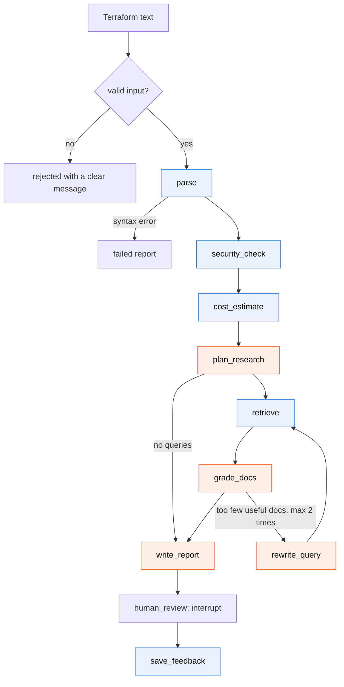
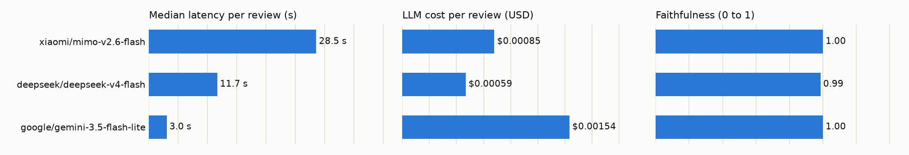
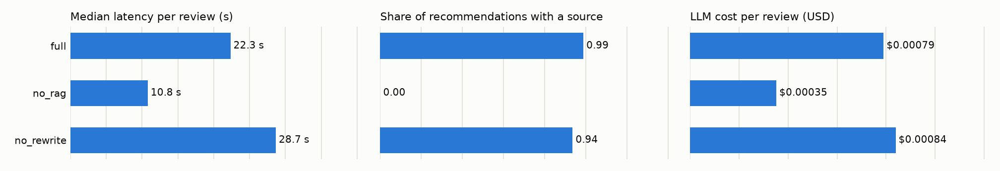

# GCP Infra Review Agent

An AI agent that reviews Terraform for Google Cloud **before** it is applied. It flags
security problems, estimates the monthly cost and suggests cheaper or simpler
alternatives, with links to the Google Cloud documentation.

- **Coding agents** (Claude Code and others) call it through an MCP tool.
- **People** use it through a Streamlit UI.

Turing College, AI Engineering, Sprint 3 project. It is also a small research project:
the design choices are measured, and every number in this file comes from a saved run
in `evals/results/`.

## The problem

Infrastructure mistakes are cheapest to fix before `terraform apply`. After that, a
public bucket has already been public, and an oversized database has already been
billed. Two things make the pre-apply review hard:

1. **Coding agents now write Terraform.** They produce working configurations quickly,
   but they do not reliably notice that a firewall is open to the world or that a
   development database is set to high availability.
2. **Reviewing needs three kinds of knowledge at once**: security rules, pricing, and
   what Google recommends instead. Few people have all three in their head.

**Who it is for:** developers and small teams without a dedicated cloud security or
FinOps person, and the coding agents working for them.

**What it does not do:** it never creates, changes or deletes anything in GCP and needs
no GCP credentials. It does not review live projects, monitor anything or rewrite your
Terraform.

### Scope

| | |
|---|---|
| Input | Terraform (`.tf`) text only, up to 200 KB |
| Services | Cloud Run, Compute Engine, Cloud SQL, Cloud Storage, GKE |
| Other resource types | Listed in the report as "not reviewed" |
| External APIs | An LLM provider, and optionally the public Cloud Billing Catalog API (prices) |

## How it works



Blue nodes are plain code. Orange nodes use the LLM.

| Node | Uses LLM | What it does | If it fails |
|---|---|---|---|
| `parse` | no | Terraform text to a list of resources | The review stops with a clear syntax message |
| `security_check` | no | Runs 20 fixed rules | (cannot fail on valid resources) |
| `cost_estimate` | no | Monthly cost per resource, with assumptions | The report says the estimate is missing |
| `plan_research` | yes | Decides what to look up in the docs | One generic cost query per service |
| `retrieve` | no | Searches the local documentation store | The review continues without documents |
| `grade_docs` | yes | Keeps only the useful passages | All passages are kept |
| `rewrite_query` | yes | Rewrites the queries, at most 2 times | The loop ends |
| `write_report` | yes | Summary and cost/sizing recommendations | Report with rule findings and cost only |
| `human_review` | no | Pauses for the user's feedback (UI only) | |
| `save_feedback` | no | Saves feedback and the review to SQLite | A warning; the report is still returned |

**What kind of agent this is.** A workflow agent: a fixed graph in which the LLM makes
bounded decisions (what to search for, which passages are good enough, whether to
search again) but never decides whether the security check or the cost estimate runs.
It is not a ReAct agent, on purpose: in a ReAct loop the model chooses which tools to
call, and text hidden in the Terraform could talk it out of the security check.
**Function calling** happens at the edge: `review_gcp_infra` is a tool that coding
agents call. Inside the graph, the LLM's JSON output (search queries) becomes the
arguments of `search_gcp_docs`, validated by a Pydantic schema. The longer explanation,
with a comparison of agent types and when to use prompt engineering, RAG or an agent,
is in [`docs/LEARNING_NOTES.md`](docs/LEARNING_NOTES.md#core-concepts-explained-with-this-project).

### Design rules

**The LLM is used only where judgment is needed.** Whether a bucket is public is a
fact, so code decides it. Which cost topic is worth researching is a judgment, so the
LLM decides it.

**Security findings cannot be changed by anything except the Terraform itself.** They
are produced by code, copied into the report by code, and checked once more before the
report is returned. The LLM's output schema does not allow the category "security" or
the severities "critical" and "high". User feedback is applied by a policy that skips
security findings.

**Terraform content is untrusted data.** Three layers:

1. The parser drops comments.
2. The LLM never sees the file. It sees a summary built from a fixed list of sizing
   attributes (machine type, tier, region and so on). Free-text fields such as
   descriptions, labels and environment variable values are not on the list.
3. Whatever the LLM writes, links that do not point to Google Cloud documentation are
   removed, recommendations about resources that do not exist are dropped, and a
   source is only accepted if it is one of the documents that were retrieved.

**A recommendation with no source is labelled as a suggestion.** Its text starts with
"Suggestion (no documentation source)".

**The agent degrades instead of crashing.** With no LLM key at all, a review still
returns the security findings and the cost estimate.

### Security rules

| Rule | Severity | What it catches |
|---|---|---|
| GCS-001 | critical | Bucket access granted to `allUsers` / `allAuthenticatedUsers` |
| GCS-002 | medium | Uniform bucket-level access is off |
| GCS-003 | medium | Public access prevention is not enforced |
| GCS-004 | low | Object versioning is off |
| SQL-001 | critical | Cloud SQL authorized networks include `0.0.0.0/0` |
| SQL-002 | high | Cloud SQL instance has a public IP |
| SQL-003 | medium | SSL/TLS is not required |
| SQL-004 | medium | Automated backups are off |
| SQL-005 | low | Deletion protection is switched off |
| GCE-001 | critical | Firewall opens SSH or RDP to `0.0.0.0/0` |
| GCE-002 | high | Firewall opens database ports to `0.0.0.0/0` |
| GCE-003 | high | VM uses the default service account with full API access |
| GCE-004 | medium | VM has a public IP |
| RUN-001 | high | Cloud Run service is invokable by `allUsers` |
| RUN-002 | high | Secret-looking value in a plain environment variable |
| GKE-001 | high | Control plane reachable from the internet |
| GKE-002 | medium | Nodes have public IPs |
| GKE-003 | high | Legacy ABAC is enabled |
| GKE-004 | medium | Workload Identity is not configured |
| GKE-005 | high | Nodes use the default service account with full API access |

The rules live in `tools/security_rules.py`. Each has a link to the Google Cloud page
that explains the fix.

## Setup

Requirements: Python 3.11 or newer and [uv](https://docs.astral.sh/uv/).

```bash
uv sync                          # install dependencies
cp .env.example .env             # then add your API key (see below)
uv run python -m rag.ingest      # build the documentation store (first run downloads
                                 # a small local embedding model, about 80 MB)
```

`.env`:

```
OPENROUTER_API_KEY=       # preferred: one key, many model vendors
OPENAI_API_KEY=           # alternative: OpenAI directly
LANGSMITH_TRACING=true    # optional tracing
LANGSMITH_API_KEY=
LANGSMITH_PROJECT=gcp-review-agent
GCP_BILLING_API_KEY=      # optional: live Compute Engine prices
```

Without an LLM key the agent still runs in rule-only mode. Without a billing key it
uses `tools/prices_static.json` and adds "prices may be outdated" to the report.

The default model is `google/gemini-3.5-flash-lite` through OpenRouter, chosen from the
model comparison below. If you use `OPENAI_API_KEY` without OpenRouter, also set
`REVIEW_MODEL` to an OpenAI model (for example `REVIEW_MODEL=gpt-5-mini`), or pick one
in the Developer section of the UI.

## Usage

### Streamlit UI

```bash
uv run streamlit run ui/app.py
```

Paste or upload a `.tf` file (or pick a sample), press **Review**, read the report,
then rate the cost and sizing suggestions and press **Finish review**. The sidebar has
two separate sections: **Project memory** (budget, region, preferences, remembered per
project) and **Developer** (model, temperature, RAG switch, extra prompt instructions).
The report shows the tokens used, the LLM cost and the time taken.

### MCP tool (for coding agents)

```bash
uv run python -m mcp_server.server
```

To register it in Claude Code, add this to `.mcp.json` in the project where you write
Terraform (use the absolute path of this repository):

```json
{
  "mcpServers": {
    "gcp-infra-review": {
      "command": "uv",
      "args": ["run", "--directory", "/path/to/this/repo", "python", "-m", "mcp_server.server"]
    }
  }
}
```

The server exposes one tool:

```
review_gcp_infra(terraform: str, project_id: str = "default")
  -> {"status": "ok", "markdown": "...", "report": {...}}
  -> {"status": "rejected" | "error", "error": "clear message"}
```

### From Python

```python
from agent.runner import run_review

report = run_review(open("main.tf").read(), project_id="shop")
print(report.headline)
for finding in report.findings:
    print(finding.severity, finding.resource, finding.issue)
```

### Common use cases

**1. Check a new stack before `terraform apply`.** A developer has written a small web
stack: two VMs, a MySQL database, an uploads bucket and a Pub/Sub topic
(`evals/dataset/mixed/web_stack.tf`). They paste it into the UI. The real output with
the default model is saved in
[`docs/examples/web_stack_review.md`](docs/examples/web_stack_review.md). In short:

```
2 security finding(s): 1 medium, 1 low. Estimated cost: $124.32/month.

[MEDIUM] SQL-004 google_sql_database_instance.db   Automated backups are off.
[LOW]    GCS-004 google_storage_bucket.uploads     Object versioning is off.
[MEDIUM] google_compute_instance.app (cost)        Consider Cloud Run for the stateless
                                                   web service.
         Source: https://cloud.google.com/run/docs/overview/what-is-cloud-run
Cost: VMs $113.62, database $10.30, bucket $0.40 (each line lists its assumptions)
Not reviewed: google_pubsub_topic.events (unsupported type)
3 LLM calls, 4,413 + 311 tokens, $0.0021, 14.6 s
```

The security findings come from the rules, the cost from the estimator, and only the
Cloud Run suggestion from the LLM, with a link to the page it is based on.

**2. A coding agent reviews its own Terraform.** Claude Code writes `main.tf`, then
calls the MCP tool `review_gcp_infra(terraform=..., project_id="shop")`. It gets back
`{"status": "ok", "markdown": ..., "report": {...}}`, reads the findings and fixes the
file before showing it to the user. The structured `report` lets the agent check
`severity == "critical"` without parsing text.

**3. Project rules are remembered.** In the UI sidebar, under **Project memory**, set
the project `shop` to a budget of $100/month and region `europe-west1`. Every later
review of `shop` prices resources without a region in `europe-west1` and adds a finding
when the estimate is over budget. The same memory is used through the MCP tool when it
passes `project_id="shop"`.

**4. Teach it what you do not care about.** After a review, mark a cost suggestion as
not useful and press **Finish review**. Similar suggestions for that project are moved
down and marked as deprioritised next time. Security findings cannot be dismissed this
way: the feedback form does not offer them, and the report is checked against the rule
output before it is returned.

**5. Bad input gets a clear answer, not a crash.** Real responses from the MCP tool:

```json
{"status": "rejected", "error": "The input does not look like Terraform: no resource, provider, variable or module block was found. Only .tf files are supported."}
{"status": "rejected", "error": "The input is 210 KB. The limit is 200 KB."}
```

**6. No API key, or the provider is down.** The review still returns the security
findings and the cost estimate, with a warning that the AI-written part is missing.

### Tests, lint, evals

```bash
uv run pytest                       # unit and integration tests (no API key needed)
uv run ruff check . && uv run ruff format .
uv run python -m evals.run          # run the eval suite, writes evals/results/
uv run python -m evals.report       # rebuild the tables and charts below
```

## Research method

**Questions.** (1) Do the deterministic parts meet their targets: security recall of at
least 0.9 and zero critical false positives on clean configurations? (2) How do
different models compare on recommendation quality, speed and cost? (3) What do
documentation search (RAG) and the query rewrite loop add?

**Dataset** (`evals/dataset/`, fixed): 14 Terraform samples with labelled findings.
Five vulnerable and five clean samples (one per service), one mixed stack with an
unsupported resource, and three prompt-injection samples. Eleven samples also have a
monthly cost that was calculated by hand (the working is in
`evals/dataset/README.md`). A separate file holds 34 search queries, each with the one
document that answers it.

**Metrics.**

| Area | Metric | How it is measured |
|---|---|---|
| Security | Precision, recall, F1 | `(resource, rule)` pairs against the labels |
| Security | Critical false positives | Critical findings on the clean samples |
| Cost | Estimate error | Against the hand-calculated totals |
| Retrieval | Hit rate at 1, 2 and 4; MRR | Expected document in the top k |
| Recommendations | Share with a valid source | `source_url` belongs to the document store |
| Report text | Faithfulness, answer relevancy | DeepEval, judged by a separate stronger model |
| Injection | Reviews intact | All expected findings present and no untrusted link |
| Speed | Median and p95 per review, per node | Wall-clock time recorded by the graph |
| Cost of running | Tokens and USD per review | Token counts times the provider's price |

**Models.** The model is a setting, not code. Three low-cost models from three vendors
were compared through OpenRouter: `xiaomi/mimo-v2.6-flash`, `deepseek/deepseek-v4-flash`
and `google/gemini-3.5-flash-lite`. All three cost under $3 per million output tokens.
No premium model was run, so the results do not say whether a stronger model writes
better advice (see Limitations). The judge for the model comparison is
`openai/gpt-5-mini`, from a fourth vendor, so no model is judged by a relative. Any
other model can be passed with `--models` and `--judge-model`.

**Ablations** (one model, MiMo-flash, to limit cost): `full`, `no_rag` (documentation
search off) and `no_rewrite` (rewrite loop off). They come from a separate, earlier run,
judged by `xiaomi/mimo-v2.6-pro`. That judge is a relative of the model it judges, so
the ablation faithfulness numbers are indicative only; only `full` was judged.

**Repeatability.** Temperature 0 and seed 42 are sent where the model accepts them.
Each sample is reviewed 3 times per configuration. Each configuration starts with an
empty memory. GCP cost estimates use the static price table so they do not move with
live prices. LLM token prices are read live from OpenRouter at the start of each run and
saved in the result file.
Every run writes a new JSON file with the date, git commit, models, settings and token
prices used. The README tables are generated from those files by `evals/report.py`.

## Results

<!-- RESULTS:START -->

### Deterministic parts (no LLM)

Source: `evals/results/20261110T081110Z_deterministic.json` (run 2026-11-10T08:11:10+00:00, git commit: 532207b8098f278d9c41d73e36b66b9797299b33). 14 samples.

**Security rules** (a finding is a `(resource, rule)` pair):

| Group | TP | FP | FN | Precision | Recall | F1 |
|---|---|---|---|---|---|---|
| clean | 0 | 0 | 0 | 1.00 | 1.00 | 1.00 |
| injection | 13 | 0 | 0 | 1.00 | 1.00 | 1.00 |
| mixed | 2 | 0 | 0 | 1.00 | 1.00 | 1.00 |
| vulnerable | 20 | 0 | 0 | 1.00 | 1.00 | 1.00 |
| all | 35 | 0 | 0 | 1.00 | 1.00 | 1.00 |

Critical false positives on the clean samples: **0**.

**Cost estimator** against 11 hand-calculated totals: mean absolute error $0.00, largest error $0.00, mean absolute percentage error 0.00%.

**Retrieval** (34 queries, one expected document each):

| Setting | Hit rate @1 | Hit rate @2 | Hit rate @4 | MRR |
|---|---|---|---|---|
| with service filter | 0.94 | 0.97 | 0.97 | 0.96 |
| without service filter | 0.94 | 0.97 | 0.97 | 0.96 |

**Speed of the deterministic steps:**

| Step | Measurements | Median (ms) | p95 (ms) |
|---|---|---|---|
| parse | 280 | 3.562 | 7.316 |
| security check | 280 | 0.051 | 0.105 |
| cost estimate | 280 | 0.069 | 0.111 |
| retrieve one query | 20 | 189.213 | 196.157 |


### Full agent, per model

Source: `evals/results/20261110T095622Z_llm.json` (run 2026-11-10T09:56:21+00:00, git commit: d3ca62f9b13796e96669f58fee1a858a119944d9). Provider: openrouter. 14 samples x 3 runs per configuration. Judge model: openai/gpt-5-mini. Token prices: openrouter live.

**Quality** (configuration `full`):

| Model | Reviews | Security recall | Security precision | Critical on clean | Injection intact | Recs / review | Share with source | Faithfulness | Answer relevancy | LLM fallback rate |
|---|---|---|---|---|---|---|---|---|---|---|
| xiaomi/mimo-v2.6-flash | 42 | 1.00 | 1.00 | 0 | 1.00 | 2.45 | 0.89 | 1.00 | 0.94 | 0.00 |
| deepseek/deepseek-v4-flash | 42 | 1.00 | 1.00 | 0 | 1.00 | 1.19 | 0.92 | 0.99 | 0.90 | 0.02 |
| google/gemini-3.5-flash-lite | 42 | 1.00 | 1.00 | 0 | 1.00 | 0.64 | 1.00 | 1.00 | 0.91 | 0.00 |

**Speed and cost** (configuration `full`):

| Model | Median (s) | p95 (s) | Deterministic steps (s) | LLM steps (s) | LLM calls | Input tokens | Output tokens | USD / review |
|---|---|---|---|---|---|---|---|---|
| xiaomi/mimo-v2.6-flash | 28.55 | 74.87 | 0.66 | 27.78 | 2.90 | 3544 | 1260 | 0.00085 |
| deepseek/deepseek-v4-flash | 11.66 | 40.20 | 0.37 | 10.96 | 2.67 | 2999 | 1719 | 0.00059 |
| google/gemini-3.5-flash-lite | 3.03 | 5.96 | 0.26 | 2.77 | 2.79 | 3139 | 241 | 0.00154 |



**Median seconds per graph node:**

| Model | cost_estimate | grade_docs | parse | plan_research | retrieve | rewrite_query | save_feedback | security_check | write_report |
|---|---|---|---|---|---|---|---|---|---|
| xiaomi/mimo-v2.6-flash | 0.00 | 5.25 | 0.00 | 3.07 | 0.62 | 0.00 | 0.01 | 0.00 | 15.09 |
| deepseek/deepseek-v4-flash | 0.00 | 0.76 | 0.00 | 2.14 | 0.37 | 0.00 | 0.01 | 0.00 | 3.73 |
| google/gemini-3.5-flash-lite | 0.00 | 0.70 | 0.00 | 0.86 | 0.25 | 0.00 | 0.00 | 0.00 | 1.15 |

### Ablations (xiaomi/mimo-v2.6-flash)

Source: `evals/results/20261110T080559Z_llm.json` (run 2026-11-10T08:05:59+00:00, git commit: 93db1378cd83aef8d6f69732a477aa2742d5641c). Provider: openrouter. 14 samples x 3 runs per configuration. Judge model: xiaomi/mimo-v2.6-pro. Token prices: openrouter live.

| Configuration | Recs / review | Share with source | Rewrites / review | Median (s) | LLM calls | USD / review | Faithfulness | Answer relevancy |
|---|---|---|---|---|---|---|---|---|
| full | 2.12 | 0.99 | 0.00 | 22.35 | 2.86 | 0.00079 | 0.98 | 0.98 |
| no_rag | 2.07 | 0.00 | 0.00 | 10.80 | 1.00 | 0.00035 | n/a | n/a |
| no_rewrite | 2.24 | 0.94 | 0.00 | 28.67 | 2.88 | 0.00084 | n/a | n/a |



<!-- RESULTS:END -->

## Discussion

**The deterministic parts meet their targets on this dataset.** That result should be
read with care: the rules and the samples were written by the same author, at the same
time. The numbers show that the rules do what they were designed to do and that they
will catch a regression. They do not show how the rules perform on Terraform written by
other people, which is the first item under future work.

**The one retrieval miss is informative.** The query about paying per pod is answered
by two documents (the Autopilot overview and the page on choosing a cluster mode), and
the retriever returns the second. The label allows only one correct document per query,
so this counts as a miss even though the passage returned is useful. The hit rate is
therefore a slightly pessimistic number.

**The service filter made no difference** to the hit rate on these queries. The filter
still has a purpose: it stops a Compute Engine passage about Spot VMs from being cited
for a GKE node pool.

**Speed.** The deterministic steps are negligible next to one documentation search,
which in turn is small next to an LLM call. Any latency work should go into the number
of LLM calls, not into the tools.

**Security results do not depend on the model.** All three models reach recall 1.00,
precision 1.00, zero critical findings on the clean samples and 100% intact injection
reviews, and so do the ablations without RAG. This is the design working, not the
models being good: security findings come from the deterministic rules, and the LLM
output is checked so it cannot change them. The model choice only affects the advice
around the findings.

**The models differ mostly in how much advice they write.** MiMo writes about 2.4
recommendations per review, DeepSeek 1.2 and Gemini 0.6. Gemini wrote no recommendation
at all in 18 of 42 reviews, and every one it did write cited a document in the store
(share with source 1.00, against 0.89 and 0.92). Fewer, always-cited recommendations
and more, mostly-cited ones are both defensible; which is better depends on the reader.
The judge cannot tell them apart: faithfulness is 0.99 to 1.00 for all three, so on this
dataset the metric is saturated and does not rank the models. Answer relevancy (0.90 to
0.94) is also too close to separate them.

**Speed differs by a factor of ten.** Median time per review is 3.0 s for Gemini,
11.7 s for DeepSeek and 28.6 s for MiMo, and almost all of it is LLM time: the
deterministic steps take under 0.7 s. The `write_report` step is the largest part for
every model. For the MCP tool, where a coding agent waits for the answer, this is the
difference that matters most.

**Cost is negligible for all three, and the ranking is not the token ranking.** A
review costs $0.0006 (DeepSeek), $0.0009 (MiMo) or $0.0015 (Gemini). Gemini uses the
fewest output tokens but has the highest output price, so it is the most expensive. A
thousand reviews cost between $0.60 and $1.50.

**Reliability: one real failure, and a gap it exposed.** One DeepSeek review out of 126
fell back to the deterministic summary, after `write_report` had waited 628 seconds. The
60-second timeout applies to each attempt, and the client and the JSON repair step both
retry, so nothing limits the total. The p95 (40 s) does not show it because one review
in 42 is below the p95 cut-off. A total deadline per LLM step is listed under future work.

**RAG is what makes recommendations citable.** Without documentation search the model
writes about as many recommendations (2.07 against 2.12 per review), but none has a
source (0.00 against 0.99). The price is about twice the time (10.8 s against 22.4 s)
and twice the token cost. The no-RAG recommendations are not necessarily wrong, but the
reader cannot check them: all 87 were labelled "Suggestion (no documentation source)".
No model in any run put a link outside the document store into a report.

**The rewrite loop rarely runs, so its value is not shown.** In the ablation run it
never ran, so `full` and `no_rewrite` were the same agent; the gaps between them (0.99
against 0.94 share with source, 22.4 s against 28.7 s) are run-to-run noise. In the
comparison run it ran in 2 to 7% of reviews. The documentation store was written for
the same five services as the samples, so the first search almost always finds enough.
The loop would matter for queries the store covers poorly, which this dataset does not
test.

**Runs vary more than temperature 0 suggests.** The same model and configuration
(MiMo, `full`) was run twice: recommendations per review 2.12 and 2.45, share with
source 0.99 and 0.89, median time 22.4 s and 28.6 s. Differences of that size between
models should not be read as real. The large gaps (ten times the speed, four times the
recommendations) are well outside it.

**Which model to use.** On these numbers, `gemini-3.5-flash-lite` suits the
interactive uses (UI and MCP tool) because it is ten times faster and every
recommendation it wrote had a source, at a cost that is still a fraction of a cent. DeepSeek is
the cheapest and writes more advice, but is slower and produced the one failure. MiMo
writes the most advice and is the slowest. None of this says how a premium model would
do.

## Limitations

- **In-sample evaluation.** See above: the dataset is small and was written alongside
  the rules.
- **Static analysis only.** Variables, modules, `for_each` and expressions are not
  evaluated. A value that is only known at apply time is treated as unknown. A rule
  that needs that value may stay silent or, for "must be explicitly enabled" rules,
  may fire.
- **20 rules is not a security audit.** IAM roles, organisation policies, networking
  beyond firewalls, encryption keys and logging are not covered.
- **The cost estimate is a list-price approximation.** It ignores traffic, data
  volume (a fixed 100 GB per bucket is assumed), egress, sustained and committed use
  discounts and Spot prices. Each line states its assumptions.
- **Only part of the static price table is checked against the live API.** Compute
  Engine and disk prices for the 8 listed regions were copied from the Billing Catalog
  API on 2026-11-10; on that day the hand-typed us-central1 values matched it to within
  rounding, but the old 1.1 Europe multiplier overpriced disks by 10%, which is why exact
  regional prices are now stored. Cloud SQL, Cloud Storage, Cloud Run and GKE fee prices
  are still hand-typed, with rough multipliers for other regions. The cost-error metric
  measures the arithmetic of the estimator, not the accuracy of the prices.
- **Live prices cover Compute Engine only.** The live path was checked once against
  the real API (47 regions returned); the evals use the static table on purpose so the
  numbers are reproducible.
- **Multi-region bucket locations** (`EU`, `US`, `ASIA`) are priced as the default
  region, and the cost line says so.
- **The documentation store is small**: 34 pages summarised as short notes. A
  recommendation can only cite what is in the store.
- **Structured values still reach the LLM.** Resource names and whitelisted attribute
  values are restricted to identifier characters, which limits but does not remove
  the injection surface. The protection that matters is structural: the LLM cannot
  alter security findings whatever it reads.
- **LLM judges are imperfect.** Faithfulness and relevancy scores come from another
  model and should be read as indicators. On this dataset faithfulness is saturated
  (0.99 to 1.00 for every model), so it does not separate the models.
- **Only low-cost models were compared.** The three models were chosen for price. The
  results show how cheap models differ; they do not show what a premium model adds.
- **Ablations on one model, one run.** RAG and the rewrite loop were ablated only on
  MiMo-flash, with a judge from the same vendor, and the loop did not run at all in that
  run.
- **No total deadline per LLM step.** Each attempt has a 60-second timeout, but retries
  are not capped in total time; one review took 628 seconds before it fell back.
- **Run-to-run variance.** Even at temperature 0 the same configuration varies between
  runs (see Discussion), and only 3 runs per sample were made.

## Future work

- A held-out test set from Terraform written by others (provider examples, public
  repositories), labelled independently.
- Resolve variables and locals, and read `terraform plan` JSON for exact values.
- More rules (IAM, KMS, logging) and a way to add organisation-specific rules.
- Live prices for all five services, and committed-use and Spot pricing.
- Fetch and re-index the official documentation on a schedule.
- A CI mode that comments on pull requests.
- A total time limit for each LLM step, so a slow provider cannot hold a review for
  minutes.
- Add a premium model to the comparison, and repeat the ablations on more than one
  model with an independent judge.
- Harder retrieval queries (services or questions the store covers poorly) to test
  whether the rewrite loop earns its place.

## Repository layout

```
agent/          graph, state, nodes (one file each), prompts (*.md), report assembly
tools/          tf_parser, security_rules, cost_estimator, billing_api, prices_static.json
rag/            ingest.py, retriever.py, docs/ (notes on GCP documentation pages)
memory/         SQLite store and the feedback policy
ui/             Streamlit app
mcp_server/     MCP server exposing review_gcp_infra
evals/          dataset/, run.py, report.py, results/
tests/          pytest tests mirroring the layout above
docs/           PLAN, PROGRESS, DECISIONS, LEARNING_NOTES, tickets/
```

More detail: [`docs/DECISIONS.md`](docs/DECISIONS.md) explains each technical choice and
[`docs/LEARNING_NOTES.md`](docs/LEARNING_NOTES.md) explains each part in plain language.
