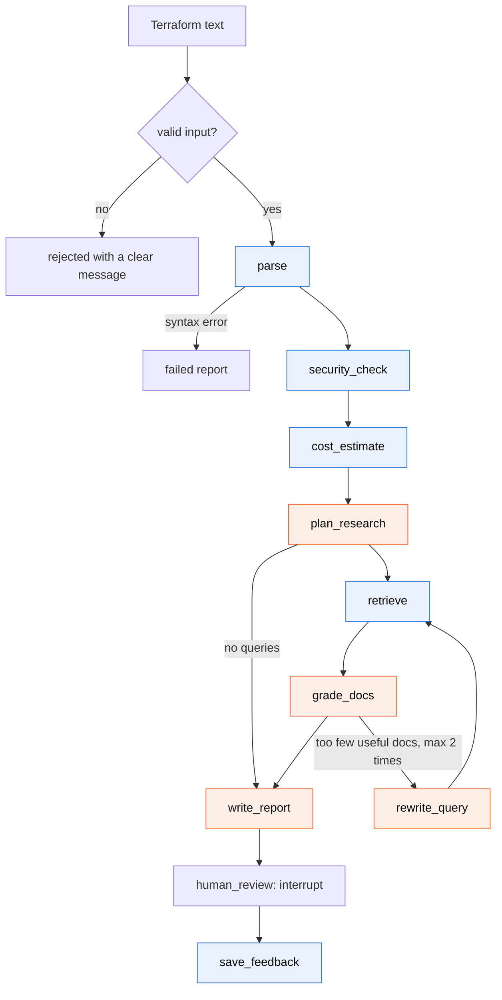
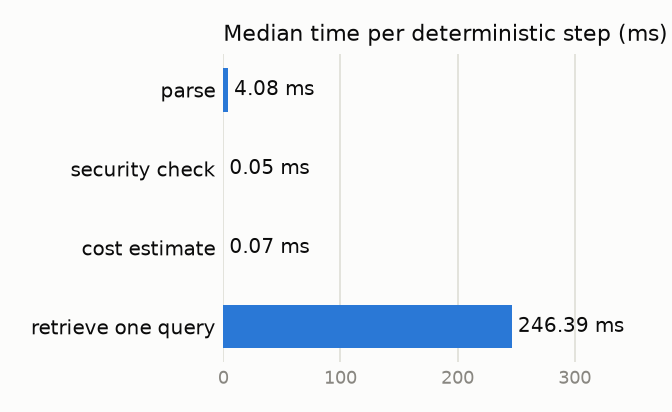

# GCP Infra Review Agent

An AI agent that reviews Terraform for Google Cloud **before** it is applied. It flags
security problems, estimates the monthly cost and suggests cheaper or simpler
alternatives, with links to the Google Cloud documentation.

- **Coding agents** (Claude Code and others) call it through an MCP tool.
- **People** use it through a Streamlit UI.

Turing College, AI Engineering, Sprint 3 project. It is also a small research project:
the design choices are measured, and every number in this file comes from a saved run
in `evals/results/`.

## The problem

Infrastructure mistakes are cheapest to fix before `terraform apply`. After that, a
public bucket has already been public, and an oversized database has already been
billed. Two things make the pre-apply review hard:

1. **Coding agents now write Terraform.** They produce working configurations quickly,
   but they do not reliably notice that a firewall is open to the world or that a
   development database is set to high availability.
2. **Reviewing needs three kinds of knowledge at once**: security rules, pricing, and
   what Google recommends instead. Few people have all three in their head.

**Who it is for:** developers and small teams without a dedicated cloud security or
FinOps person, and the coding agents working for them.

**What it does not do:** it never creates, changes or deletes anything in GCP and needs
no GCP credentials. It does not review live projects, monitor anything or rewrite your
Terraform.

### Scope

| | |
|---|---|
| Input | Terraform (`.tf`) text only, up to 200 KB |
| Services | Cloud Run, Compute Engine, Cloud SQL, Cloud Storage, GKE |
| Other resource types | Listed in the report as "not reviewed" |
| External APIs | An LLM provider, and optionally the public Cloud Billing Catalog API (prices) |

## How it works



Blue nodes are plain code. Orange nodes use the LLM.

| Node | Uses LLM | What it does | If it fails |
|---|---|---|---|
| `parse` | no | Terraform text to a list of resources | The review stops with a clear syntax message |
| `security_check` | no | Runs 20 fixed rules | (cannot fail on valid resources) |
| `cost_estimate` | no | Monthly cost per resource, with assumptions | The report says the estimate is missing |
| `plan_research` | yes | Decides what to look up in the docs | One generic cost query per service |
| `retrieve` | no | Searches the local documentation store | The review continues without documents |
| `grade_docs` | yes | Keeps only the useful passages | All passages are kept |
| `rewrite_query` | yes | Rewrites the queries, at most 2 times | The loop ends |
| `write_report` | yes | Summary and cost/sizing recommendations | Report with rule findings and cost only |
| `human_review` | no | Pauses for the user's feedback (UI only) | |
| `save_feedback` | no | Saves feedback and the review to SQLite | A warning; the report is still returned |

### Design rules

**The LLM is used only where judgment is needed.** Whether a bucket is public is a
fact, so code decides it. Which cost topic is worth researching is a judgment, so the
LLM decides it.

**Security findings cannot be changed by anything except the Terraform itself.** They
are produced by code, copied into the report by code, and checked once more before the
report is returned. The LLM's output schema does not allow the category "security" or
the severities "critical" and "high". User feedback is applied by a policy that skips
security findings.

**Terraform content is untrusted data.** Three layers:

1. The parser drops comments.
2. The LLM never sees the file. It sees a summary built from a fixed list of sizing
   attributes (machine type, tier, region and so on). Free-text fields such as
   descriptions, labels and environment variable values are not on the list.
3. Whatever the LLM writes, links that do not point to Google Cloud documentation are
   removed, recommendations about resources that do not exist are dropped, and a
   source is only accepted if it is one of the documents that were retrieved.

**A recommendation with no source is labelled as a suggestion.** Its text starts with
"Suggestion (no documentation source)".

**The agent degrades instead of crashing.** With no LLM key at all, a review still
returns the security findings and the cost estimate.

### Security rules

| Rule | Severity | What it catches |
|---|---|---|
| GCS-001 | critical | Bucket access granted to `allUsers` / `allAuthenticatedUsers` |
| GCS-002 | medium | Uniform bucket-level access is off |
| GCS-003 | medium | Public access prevention is not enforced |
| GCS-004 | low | Object versioning is off |
| SQL-001 | critical | Cloud SQL authorized networks include `0.0.0.0/0` |
| SQL-002 | high | Cloud SQL instance has a public IP |
| SQL-003 | medium | SSL/TLS is not required |
| SQL-004 | medium | Automated backups are off |
| SQL-005 | low | Deletion protection is switched off |
| GCE-001 | critical | Firewall opens SSH or RDP to `0.0.0.0/0` |
| GCE-002 | high | Firewall opens database ports to `0.0.0.0/0` |
| GCE-003 | high | VM uses the default service account with full API access |
| GCE-004 | medium | VM has a public IP |
| RUN-001 | high | Cloud Run service is invokable by `allUsers` |
| RUN-002 | high | Secret-looking value in a plain environment variable |
| GKE-001 | high | Control plane reachable from the internet |
| GKE-002 | medium | Nodes have public IPs |
| GKE-003 | high | Legacy ABAC is enabled |
| GKE-004 | medium | Workload Identity is not configured |
| GKE-005 | high | Nodes use the default service account with full API access |

The rules live in `tools/security_rules.py`. Each has a link to the Google Cloud page
that explains the fix.

## Setup

Requirements: Python 3.11 or newer and [uv](https://docs.astral.sh/uv/).

```bash
uv sync                          # install dependencies
cp .env.example .env             # then add your API key (see below)
uv run python -m rag.ingest      # build the documentation store (first run downloads
                                 # a small local embedding model, about 80 MB)
```

`.env`:

```
OPENROUTER_API_KEY=       # preferred: one key, many model vendors
OPENAI_API_KEY=           # alternative: OpenAI directly
LANGSMITH_TRACING=true    # optional tracing
LANGSMITH_API_KEY=
LANGSMITH_PROJECT=gcp-review-agent
GCP_BILLING_API_KEY=      # optional: live Compute Engine prices
```

Without an LLM key the agent still runs in rule-only mode. Without a billing key it
uses `tools/prices_static.json` and adds "prices may be outdated" to the report.

## Usage

### Streamlit UI

```bash
uv run streamlit run ui/app.py
```

Paste or upload a `.tf` file (or pick a sample), press **Review**, read the report,
then rate the cost and sizing suggestions and press **Finish review**. The sidebar has
two separate sections: **Project memory** (budget, region, preferences, remembered per
project) and **Developer** (model, temperature, RAG switch, extra prompt instructions).
The report shows the tokens used, the LLM cost and the time taken.

### MCP tool (for coding agents)

```bash
uv run python -m mcp_server.server
```

To register it in Claude Code, add this to `.mcp.json` in the project where you write
Terraform (use the absolute path of this repository):

```json
{
  "mcpServers": {
    "gcp-infra-review": {
      "command": "uv",
      "args": ["run", "--directory", "/path/to/this/repo", "python", "-m", "mcp_server.server"]
    }
  }
}
```

The server exposes one tool:

```
review_gcp_infra(terraform: str, project_id: str = "default")
  -> {"status": "ok", "markdown": "...", "report": {...}}
  -> {"status": "rejected" | "error", "error": "clear message"}
```

### From Python

```python
from agent.runner import run_review

report = run_review(open("main.tf").read(), project_id="shop")
print(report.headline)
for finding in report.findings:
    print(finding.severity, finding.resource, finding.issue)
```

### Tests, lint, evals

```bash
uv run pytest                       # unit and integration tests (no API key needed)
uv run ruff check . && uv run ruff format .
uv run python -m evals.run          # run the eval suite, writes evals/results/
uv run python -m evals.report       # rebuild the tables and charts below
```

## Research method

**Questions.** (1) Do the deterministic parts meet their targets: security recall of at
least 0.9 and zero critical false positives on clean configurations? (2) How do
different models compare on recommendation quality, speed and cost? (3) What do
documentation search (RAG) and the query rewrite loop add?

**Dataset** (`evals/dataset/`, fixed): 14 Terraform samples with labelled findings.
Five vulnerable and five clean samples (one per service), one mixed stack with an
unsupported resource, and three prompt-injection samples. Eleven samples also have a
monthly cost that was calculated by hand (the working is in
`evals/dataset/README.md`). A separate file holds 34 search queries, each with the one
document that answers it.

**Metrics.**

| Area | Metric | How it is measured |
|---|---|---|
| Security | Precision, recall, F1 | `(resource, rule)` pairs against the labels |
| Security | Critical false positives | Critical findings on the clean samples |
| Cost | Estimate error | Against the hand-calculated totals |
| Retrieval | Hit rate at 1, 2 and 4; MRR | Expected document in the top k |
| Recommendations | Share with a valid source | `source_url` belongs to the document store |
| Report text | Faithfulness, answer relevancy | DeepEval, judged by a separate stronger model |
| Injection | Reviews intact | All expected findings present and no untrusted link |
| Speed | Median and p95 per review, per node | Wall-clock time recorded by the graph |
| Cost of running | Tokens and USD per review | Token counts times the provider's price |

**Models.** The model is a setting, not code. The default eval compares three models
through OpenRouter: `openai/gpt-6-luna` (small and cheap), `google/gemini-3.1-flash-lite`
and `openai/gpt-6.1-terra`. The judge is `openai/gpt-6.1-sol`. Any other model can be
passed with `--models`.

**Ablations** (first model only, to limit cost): `full`, `no_rag` (documentation search
off) and `no_rewrite` (rewrite loop off).

**Repeatability.** Temperature 0 and seed 42 are sent where the model accepts them.
Each sample is reviewed 3 times per configuration. Each configuration starts with an
empty memory. Costs use the static price table so they do not move with live prices.
Every run writes a new JSON file with the date, git commit, models, settings and token
prices used. The README tables are generated from those files by `evals/report.py`.

## Results

<!-- RESULTS:START -->

### Deterministic parts (no LLM)

Source: `evals/results/20261109T201508Z_deterministic.json` (run 2026-11-09T20:15:08+00:00, git commit: no commits yet). 14 samples.

**Security rules** (a finding is a `(resource, rule)` pair):

| Group | TP | FP | FN | Precision | Recall | F1 |
|---|---|---|---|---|---|---|
| clean | 0 | 0 | 0 | 1.00 | 1.00 | 1.00 |
| injection | 13 | 0 | 0 | 1.00 | 1.00 | 1.00 |
| mixed | 2 | 0 | 0 | 1.00 | 1.00 | 1.00 |
| vulnerable | 20 | 0 | 0 | 1.00 | 1.00 | 1.00 |
| all | 35 | 0 | 0 | 1.00 | 1.00 | 1.00 |

Critical false positives on the clean samples: **0**.

**Cost estimator** against 11 hand-calculated totals: mean absolute error $0.00, largest error $0.00, mean absolute percentage error 0.00%.

**Retrieval** (34 queries, one expected document each):

| Setting | Hit rate @1 | Hit rate @2 | Hit rate @4 | MRR |
|---|---|---|---|---|
| with service filter | 0.94 | 0.97 | 0.97 | 0.96 |
| without service filter | 0.94 | 0.97 | 0.97 | 0.96 |

**Speed of the deterministic steps:**

| Step | Measurements | Median (ms) | p95 (ms) |
|---|---|---|---|
| parse | 280 | 4.076 | 9.827 |
| security check | 280 | 0.046 | 0.121 |
| cost estimate | 280 | 0.067 | 0.133 |
| retrieve one query | 20 | 246.388 | 294.727 |



### Full agent, per model

**Not run yet.** No result file exists for the LLM evaluation, so there are no numbers to show here. Set `OPENROUTER_API_KEY` in `.env`, then run `uv run python -m evals.run` and `uv run python -m evals.report`. This section, the model comparison and the ablation tables are then filled in from the saved run.

<!-- RESULTS:END -->

## Discussion

**The deterministic parts meet their targets on this dataset.** That result should be
read with care: the rules and the samples were written by the same author, at the same
time. The numbers show that the rules do what they were designed to do and that they
will catch a regression. They do not show how the rules perform on Terraform written by
other people, which is the first item under future work.

**The one retrieval miss is informative.** The query about paying per pod is answered
by two documents (the Autopilot overview and the page on choosing a cluster mode), and
the retriever returns the second. The label allows only one correct document per query,
so this counts as a miss even though the passage returned is useful. The hit rate is
therefore a slightly pessimistic number.

**The service filter made no difference** to the hit rate on these queries. The filter
still has a purpose: it stops a Compute Engine passage about Spot VMs from being cited
for a GKE node pool.

**Speed.** The deterministic steps are negligible next to one documentation search,
which in turn is small next to an LLM call. Any latency work should go into the number
of LLM calls, not into the tools.

The model comparison and the ablations will be discussed here once the LLM evaluation
has been run. No conclusions are drawn before the numbers exist.

## Limitations

- **In-sample evaluation.** See above: the dataset is small and was written alongside
  the rules.
- **Static analysis only.** Variables, modules, `for_each` and expressions are not
  evaluated. A value that is only known at apply time is treated as unknown. A rule
  that needs that value may stay silent or, for "must be explicitly enabled" rules,
  may fire.
- **20 rules is not a security audit.** IAM roles, organisation policies, networking
  beyond firewalls, encryption keys and logging are not covered.
- **The cost estimate is a list-price approximation.** It ignores traffic, data
  volume (a fixed 100 GB per bucket is assumed), egress, sustained and committed use
  discounts and Spot prices. Each line states its assumptions.
- **Only part of the static price table is checked against the live API.** Compute
  Engine and disk prices for the 8 listed regions were copied from the Billing Catalog
  API on 2026-11-10; on that day the hand-typed us-central1 values matched it to within
  rounding, but the old 1.1 Europe multiplier overpriced disks by 10%, which is why exact
  regional prices are now stored. Cloud SQL, Cloud Storage, Cloud Run and GKE fee prices
  are still hand-typed, with rough multipliers for other regions. The cost-error metric
  measures the arithmetic of the estimator, not the accuracy of the prices.
- **Live prices cover Compute Engine only.** The live path was checked once against
  the real API (47 regions returned); the evals use the static table on purpose so the
  numbers are reproducible.
- **Multi-region bucket locations** (`EU`, `US`, `ASIA`) are priced as the default
  region, and the cost line says so.
- **The documentation store is small**: 34 pages summarised as short notes. A
  recommendation can only cite what is in the store.
- **Structured values still reach the LLM.** Resource names and whitelisted attribute
  values are restricted to identifier characters, which limits but does not remove
  the injection surface. The protection that matters is structural: the LLM cannot
  alter security findings whatever it reads.
- **LLM judges are imperfect.** Faithfulness and relevancy scores come from another
  model and should be read as indicators.

## Future work

- A held-out test set from Terraform written by others (provider examples, public
  repositories), labelled independently.
- Resolve variables and locals, and read `terraform plan` JSON for exact values.
- More rules (IAM, KMS, logging) and a way to add organisation-specific rules.
- Live prices for all five services, and committed-use and Spot pricing.
- Fetch and re-index the official documentation on a schedule.
- A CI mode that comments on pull requests.

## Repository layout

```
agent/          graph, state, nodes (one file each), prompts (*.md), report assembly
tools/          tf_parser, security_rules, cost_estimator, billing_api, prices_static.json
rag/            ingest.py, retriever.py, docs/ (notes on GCP documentation pages)
memory/         SQLite store and the feedback policy
ui/             Streamlit app
mcp_server/     MCP server exposing review_gcp_infra
evals/          dataset/, run.py, report.py, results/
tests/          pytest tests mirroring the layout above
docs/           PLAN, PROGRESS, DECISIONS, LEARNING_NOTES, tickets/
```

More detail: [`docs/DECISIONS.md`](docs/DECISIONS.md) explains each technical choice and
[`docs/LEARNING_NOTES.md`](docs/LEARNING_NOTES.md) explains each part in plain language.
