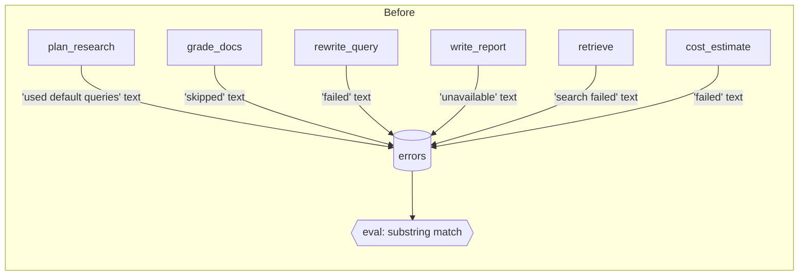
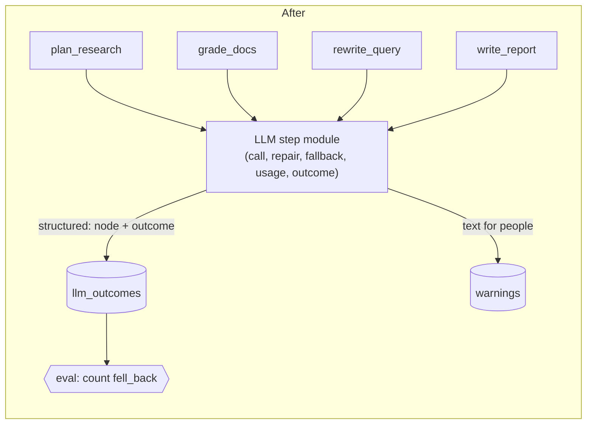
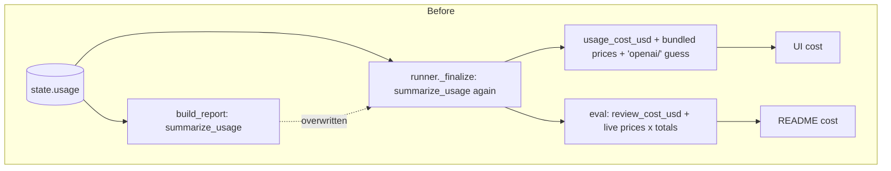
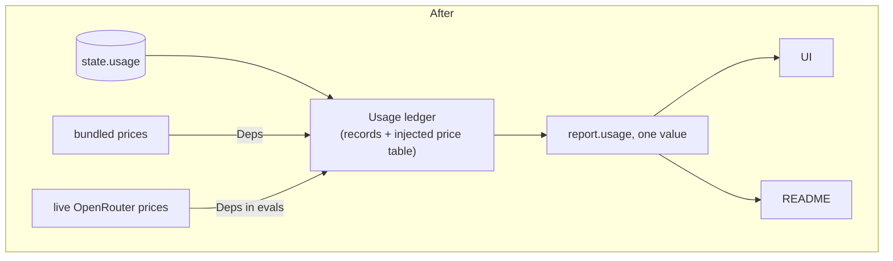
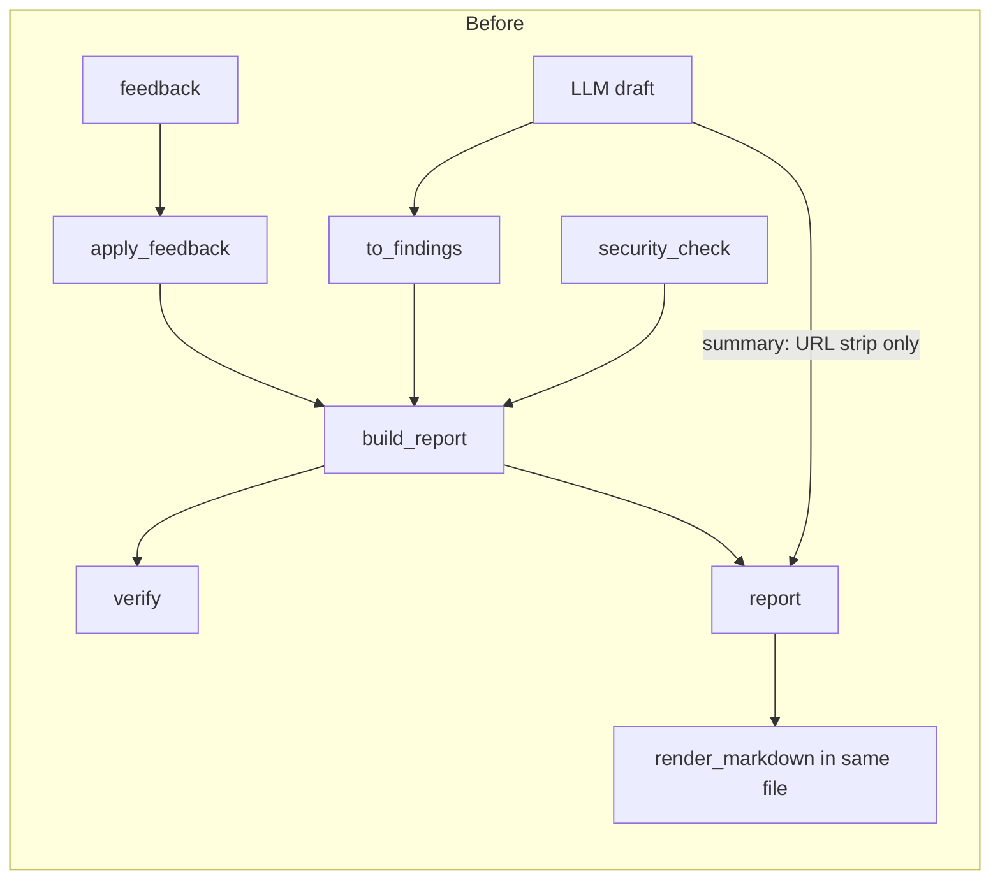
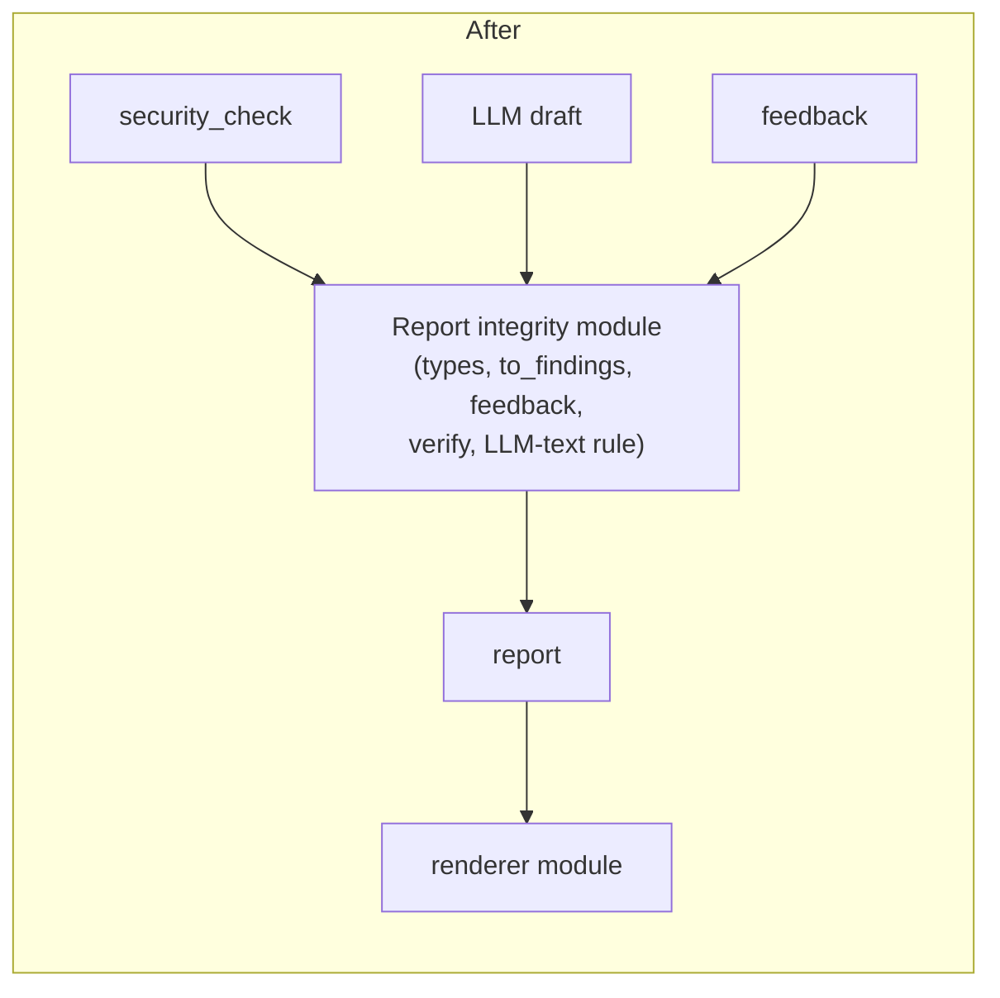
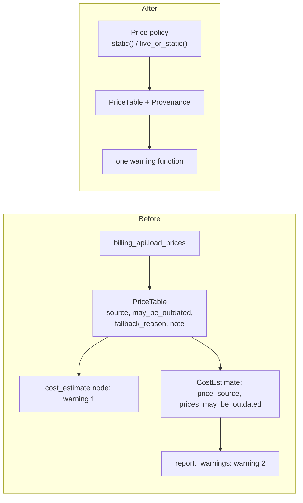
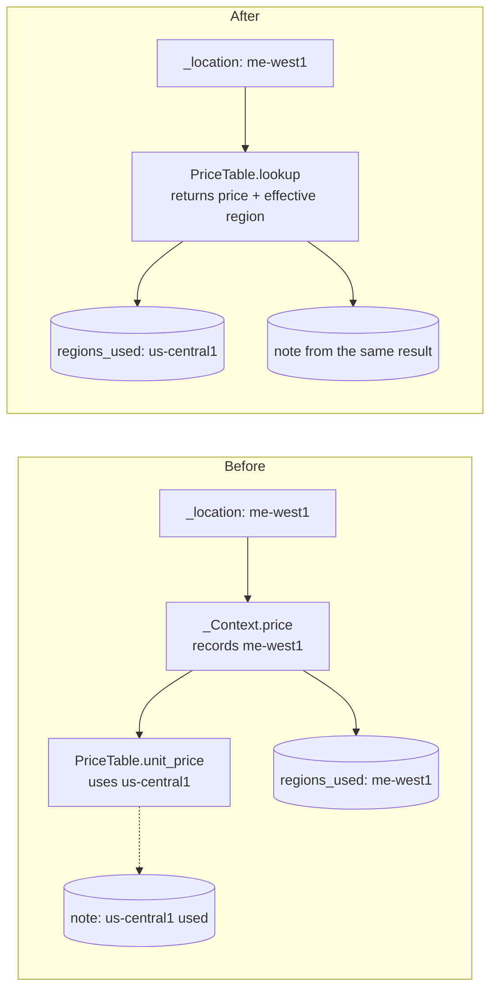

# Architecture review, 2026-11-10

Scope: the whole repository at commit `93db137` (the only commit, so there is no change
history to find hot spots in). The review looks most closely at the code that the next
tickets touch: the LLM nodes, usage and cost accounting, and prices. Those feed the paid
eval runs and the README numbers.

Terms: **module**, **interface**, **depth**, **seam**, **adapter**, **leverage** and
**locality** are used as in the `codebase-design` skill. Recorded decisions are the
numbered entries in `docs/DECISIONS.md`. There is no `GLOSSARY.md` yet.

"Node" always means a **LangGraph node**: one step of the agent graph (`agent/nodes/*.py`,
for example `plan_research` or `write_report`). It has nothing to do with Node.js. The
project is Python only, and the front end is Streamlit (`ui/app.py`).

---

## Highest-priority check: can feedback, memory or LLM output remove or downgrade a critical security finding?

**In the data: no path was found.** The guarantee holds at five points:

| Where | What stops it |
|---|---|
| `security_check` node | It reads only `state.resources`, never feedback, memory or LLM output |
| `Recommendation` type in `agent/report.py` | `category` cannot be `security`, and `severity` cannot be above `medium` |
| `memory/feedback_policy.py` | `PROTECTED_CATEGORIES` blocks deprioritising security findings, whatever the feedback says |
| `verify_security_findings` | It compares the final security findings with the rule output field by field and raises `SecurityIntegrityError` if any differ |
| UI feedback form | It offers feedback only on non-security findings |

**In what the reader sees: there is a gap.** Free text written by the LLM is never checked
against the security findings:

- `summary` is shown at the top of the UI and the Markdown, above the security findings.
  A model that reads an injected or misleading context could write "No serious security
  issues were found" next to a CRITICAL finding. The `headline` is safe because code
  writes it, but the summary sits right under it.
- A cost recommendation can target the same resource as a critical finding and contradict
  it. For example, "public IP is fine here, remove the NAT to save $32/month" next to
  SQL-002.

The data stays correct, but the reader can still be misled. This is candidate 3 below.

---

## Candidate 1: LLM step outcomes are reported only as text

**Recommendation strength: `Strong`**

**Files:** `agent/nodes/plan_research.py`, `grade_docs.py`, `rewrite_query.py`,
`write_report.py`, `agent/llm.py`, `agent/state.py`, `evals/llm_eval.py`

**Problem.** The four LLM nodes each repeat the same steps: build the payload, call
`call_json`, catch `LLMCallError`, choose a fallback, return `usage`, `errors` and
`stop_research`. Each one writes its own wording for "I fell back". The only record of
the fallback is that English sentence in `errors`, which later becomes `report.warnings`.

The eval then works the fallback out again from the text. `llm_eval.score_review` looks
for any of `"unavailable"`, `"default queries"`, `"skipped"` or `"failed"` in the
warnings. This crosses the seam: the eval depends on how the nodes word their messages.
It also already gives wrong results:

- A Chroma failure ("Documentation search failed") counts as an **LLM** fallback.
- A failed cost estimate ("Cost estimate failed") counts as an LLM fallback.
- A Billing API error whose message contains "failed" would mark **every** review as an
  LLM fallback once a GCP key is set (ticket 10).

So `llm_fallback_rate`, which will be one of the model comparison numbers, is not
measuring what its name says.

**Solution.** Deepen the `call_json` module into an *LLM step* module. Its interface
returns one result that holds the parsed value or the fallback value, the usage, and a
structured outcome (`ok` / `repaired` / `fell_back`, plus the node name). State gets one
reducer field that lists the fallbacks per node. Nodes keep only their own logic: the
payload, the schema and what the fallback value is. The eval reads the structured field.
Warnings stay as text for people to read.

**Benefits.**
- *Locality:* the fallback convention (record usage, set `stop_research`, word the
  warning) lives in one place, not four. A fifth LLM node gets it for free.
- *Leverage:* the eval, the UI and the report all read one fact instead of guessing it.
- *Tests:* one test file covers "LLM fails → fallback recorded", and node tests shrink to
  their own logic. The current graph tests that check warning wording can check the
  structured outcome instead, which does not break when a message is reworded.





Fits decision 4 ("JSON mode with our own validation") and builds on it.

---

## Candidate 2: Token usage and LLM cost are worked out in three places with two price sources

**Recommendation strength: `Strong`**

**Files:** `agent/llm.py` (`usage_cost_usd`, `model_name`, `load_model_prices`),
`agent/report.py` (`summarize_usage`), `agent/runner.py` (`_finalize`),
`evals/llm_eval.py` (`review_cost_usd`), `evals/run.py` (`fetch_model_prices`)

**Problem.**
- `build_report` summarises usage from `state.usage + new_usage`. Then `runner._finalize`
  throws that away and summarises again from the final state. That is two code paths for
  one number.
- The cost the UI shows uses the bundled `model_prices.json`. The cost the eval reports
  uses live OpenRouter prices (`fetch_model_prices`) and multiplies the **report totals**
  by a single model's price. The same review can therefore show one cost in the UI and
  another in the README.
- `usage_cost_usd` finds a price by trying `model` and then `openai/{model}`. This works
  around `model_name()` returning the name without the vendor prefix when the OpenAI
  provider is used. Price lookup depends on how the client happens to store its model
  name.

Cost per review and per model is one of the research metrics, and tickets 12 and 13 will
publish it.

**Solution.** One *usage ledger* module. Its interface takes `UsageRecord`s and a price
table and returns `UsageSummary` with the cost. The price table is a dependency (on
`Deps`), so the UI uses the bundled snapshot, the eval injects the live OpenRouter
prices, and both go through the same calculation. The runner summarises once.
`UsageRecord.model` stores the configured model id from `Settings`, not whatever the
client reports.

**Benefits.**
- *Locality:* one place decides how a review is priced. When the README cost and the UI
  cost disagree, there is only one module to look at.
- *Leverage:* the judge's cost can go through the same ledger later at no extra cost.
- *Tests:* hand-calculated literals against a fixed price table, through one interface.
  The eval test no longer needs its own cost arithmetic.





---

## Candidate 3: The "security cannot be overridden" guarantee has no single home

**Recommendation strength: `Worth exploring`**

**Files:** `agent/report.py` (`Recommendation`, `to_findings`,
`verify_security_findings`, `strip_untrusted_urls`, `build_report`),
`agent/summary.py`, `memory/feedback_policy.py`, `agent/nodes/write_report.py`,
`ui/app.py`

**Problem.** The most important rule in the project is spread across five modules (see
the table above). Each part is correct, but nothing ties them together:

- `agent/report.py` mixes three jobs: enforcing the guards on LLM output, assembling the
  report (warnings, sources, usage), and rendering Markdown. Someone adding a new field
  that the LLM writes (for example `title`, or a per-finding `rationale`) has no single
  place that reminds them to guard it.
- The free-text gap described at the top: `summary` and the text of recommendations are
  cleaned of URLs but never checked against the security findings.

**Solution.** Deepen `build_report` into a *report integrity* module. It is the only
place where LLM output enters the report. Its interface takes the deterministic results,
the draft and the feedback, and returns a report that is valid by construction. It owns:
the type limits, `to_findings`, feedback application, the final verification, and a rule
for LLM text next to security findings. Options for that rule, to decide together:

- (a) Show the summary *below* the security findings and label it "AI-written".
- (b) Drop or mark recommendations that target a resource which has a critical or high
  security finding.
- (c) A deterministic check on the summary, such as rejecting "no security issues" when
  critical findings exist. Brittle; probably not worth it.

Rendering (`render_markdown`) moves out into its own module.

**Benefits.**
- *Locality:* the live review question "where is the security guarantee enforced?" has a
  one-file answer.
- *Tests:* the injection tests and the feedback-on-security tests aim at one interface.
  The free-text gap gets a test.





Strengthens decisions 2, 3 and 9. Re-opens none of them.

---

## Candidate 4: Price provenance travels in five loose fields

**Recommendation strength: `Worth exploring`**

**Files:** `tools/pricing.py`, `tools/billing_api.py` (`load_prices`), `agent/deps.py`
(`Deps.prices`), `agent/nodes/cost_estimate.py`, `agent/report.py` (`_warnings`),
`evals/deterministic.py`

**Problem.**
- Where a price came from is spread over `PriceTable.source`, `.may_be_outdated`,
  `.fallback_reason`, `.note`, and `CostEstimate.price_source` /
  `.prices_may_be_outdated`.
- Two modules turn those fields into warnings: the `cost_estimate` node writes "Billing
  API not used: …" and `report._warnings` writes "Prices may be outdated…".
- `Deps.prices()` caches for the lifetime of the `Deps` object. The UI caches
  `ReviewSession` per settings, so a failed Billing API call is remembered for the
  whole Streamlit process, and live prices never refresh.
- The eval bypasses all of this with `load_static_prices()`. That choice is right, but
  it is invisible.

Ticket 10 (live Billing API and snapshot refresh) will work in exactly this area.

**Solution.** One provenance value object on `PriceTable`: source, snapshot date, and the
fallback reason if any. One function turns it into report warnings. Price loading is an
explicit policy: `static()` for evals, `live_or_static(client, max_age)` for reviews.
Only the latter caches, with an expiry.

**Benefits.** *Locality* for ticket 10. The "prices may be outdated" rule from CLAUDE.md
lives in one place, and the eval's static-only choice becomes visible in code.



Consistent with decision 11.

---

## Candidate 5: Every consumer walks the raw Terraform attribute dicts

**Recommendation strength: `Speculative`**

**Files:** `tools/tf_values.py`, `tools/security_rules.py`, `tools/cost_estimator.py`,
`agent/summary.py`

`Resource.attributes` is the raw python-hcl2 dictionary, where blocks are lists. Each of
the three consumers has to know that shape, and `tf_values` provides small helpers
(`first_block`, `dig`, `literal_str`) that each one must learn. Typed views per resource
type would be deeper. However, the deletion test says `tf_values` already concentrates
most of the complexity, the scope is fixed at five services, and nothing in the next
tickets touches this. Leave it unless the rule set grows.

---

## Other observations (not candidates)

- **Coarse feedback key for LLM advice.** `Finding.feedback_key` is
  `category:resource_type` when there is no `rule_id`. Dismissing one cost suggestion on
  one VM therefore deprioritises *all* future cost suggestions for *every*
  `google_compute_instance` in that project. This does not affect security, but it is
  worth mentioning in the live review, or narrowing.
- `parse` returning a `failed_report` and routing to `END` works, but it is the only node
  that builds a report itself. It is fine at this size.

---

## Update (same day): the uncommitted `default_region` / `regions_used` change

A second pass found uncommitted work in `tools/cost_estimator.py`, `tools/models.py`,
`agent/report.py` and two test files. `CostEstimate.region` became `default_region`
plus `regions_used`. This is now the hot spot, so it gets two candidates of its own.
State of the working tree: `uv run pytest` gives 126 passed. `uv run ruff check .`
gives **1 error**: the new line 239 in `agent/report.py` is longer than the line limit.

### Candidate 6: Region resolution is decided in one module and reported by another

**Recommendation strength: `Strong`** (it fixes a wrong number that a user would see)

**Files:** `tools/pricing.py` (`PriceTable.knows_region`, `unit_price`),
`tools/cost_estimator.py` (`_Context.price`, `_location`), `agent/report.py`
(`_cost_section`)

**Problem.** `PriceTable.unit_price` decides which region's prices are actually used: an
unknown region quietly falls back to `base_region`. `_Context.price` records the region
that was *asked for* in `regions_used`. The two disagree whenever a region is not in the
table. Reproduced on the current working tree with a VM in zone `me-west1-a`:

```
regions_used: ['me-west1']
notes: ["No prices for region 'me-west1': us-central1 prices were used."]
```

The Markdown header says "priced in: me-west1" and a note lower down says the
opposite. The fallback is decided in one module and its consequences are reported by
another, so "which region did we price in" has two answers. A region is also recorded
when the lookup then fails with `PriceNotFoundError`, so a resource that was not priced
can still add a region.

**Solution.** Have the price lookup return the region it actually used together with the
price (one method on `PriceTable`). `_Context` records that effective region. The
"No prices for region" note is generated from the same result, so the header and the
note cannot disagree.

**Benefits.**
- *Locality:* the fallback rule and its reporting live together.
- *Tests:* one estimator test for an unknown region checks the header, the note and
  `regions_used` together. The new test only covers a known region (`europe-west1`), so
  it does not catch this.



### Candidate 7: Two renderers of one report drift apart

**Recommendation strength: `Worth exploring`**

**Files:** `agent/report.py` (`render_markdown`, `_cost_section`, `_findings_section`),
`ui/app.py` (`show_cost`, `show_finding`, `show_report`)

**Problem.** The report is rendered twice: as Markdown (MCP tool, download button) and as
Streamlit widgets. Each knows the `ReviewReport` fields on its own. The new
"priced in" information was added to the Markdown only, so the UI still shows no region
at all. Every future report field has to be added in two places, and nothing fails when
one is missed.

**Solution.** One *report view* module turns a `ReviewReport` into display-ready
sections (headline, findings grouped as security and advice, cost table rows, notes,
run details). The Markdown renderer and the Streamlit UI become two thin adapters over
it. Two adapters exist today, so the seam is real.

**Benefits.**
- *Locality:* a new field is added once.
- *Tests:* the view model is tested as plain data. The Markdown and AppTest tests check
  only layout.

Goes together with candidate 3, which also moves rendering out of `agent/report.py`.

---

## Top recommendation

**Do candidate 1 and then candidate 2 before the paid eval runs (tickets 12 and 13).**
Both decide whether the numbers that go into the README mean what they claim.
`llm_fallback_rate` is already counting retriever and pricing failures, and the per-model
cost can differ between the UI and the README. Fixing them afterwards means paying for
the runs again. They are small and touch the same files (the LLM nodes, `agent/llm.py`,
`runner`, `llm_eval`), so they can be one ticket placed before ticket 12.

**Before that, finish the work in progress with candidate 6.** It is small, the code
is already open, and right now the report states a pricing region that was not used.
Fixing the ruff error belongs to the same change.

Candidate 3 comes next. It is the best live-review talking point ("where is the security
guarantee enforced?"), and the free-text gap is a real, if small, risk.
